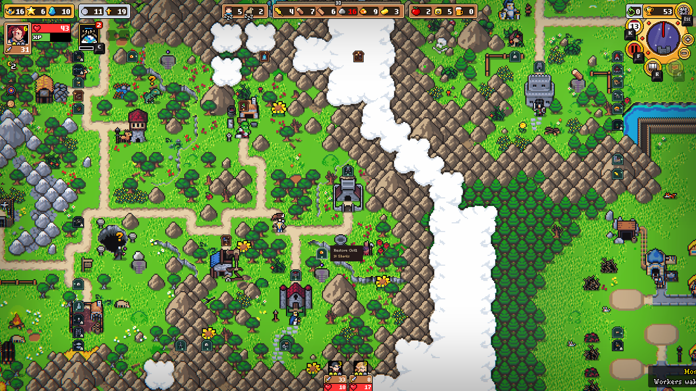
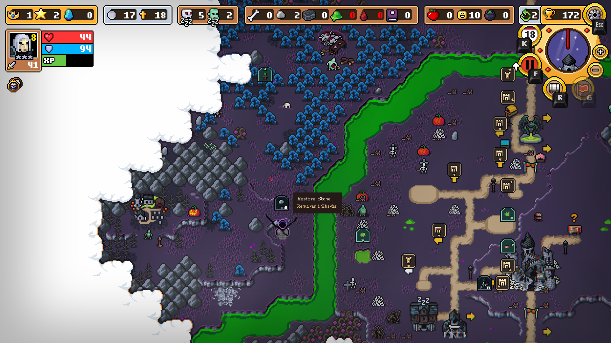

# Scout’s Map

Scout’s Map is a BepInEx navigation mod for Super Fantasy Kingdom. See the [player guide](thunderstore/README.md) for controls, marker settings, and installation.

## Discovery and availability

| Destination | Native signal |
| --- | --- |
| Road, city, and water expansion | Existing road arrow and remaining road parts. Uses the game’s day, glory, kingdom level, stars, and affordability checks. |
| Shops and Black Market | Registered building on an uncovered tile with a visible sprite. Uses the shop’s visible setup countdown and interactability. |
| Trading Post | The building’s native trade overlay and real trade buttons. The badge is locked when the player has fewer than five units of every resource accepted at that post. |
| Chests, hermits, world rewards, spells, traps, offers, drops, and recruits | The stock world marker announces the encounter. The target must remain active. Prices, spell slots, and roster restrictions follow the game’s current rules. |
| Monsters to provoke | A native provocation encounter on an uncovered tile. The badge checks the native work hours, pending provocation, boss and glory rush gates. |
| Hero encounters | The game’s marker or the revealed hero’s active position. Remaining kills distinguish a quest in progress from an unlock ready to claim. |
| Quest sites and boards | An uncovered, interactable site or a native marker. Open and turn-in badges follow the native objective and can be toggled independently. Finished quest chains are omitted. |
| Restoration | Native damage, remaining repairs, or an unrestored spot. Fixed-cost actions read the native price. Multi-option plots point to the building chooser. |
| Pirates and Wonders | Uses the native expedition, purchase, or reward state and checks any fixed price. |
| Witch bonfires, hospitals, and trades | A revealed, interactable site. Star, eligible unit, and resource checks determine whether to lock the badge. |
| Optional rare finds, coastal salvage, and cages | Stock pickup markers for rare finds and selected salvage. Cages require a revealed site and the game’s hint or achievement-ready indicator. |

The mod uses stock arrows to discover transient encounters and tracks each encounter while the target remains eligible. On-screen markers sit centered above targets when there is space inside the HUD-safe frame. Off-screen destinations and targets behind the HUD use directional badges. When markers would overlap, the marker with placement priority is shown.

Routine resources, decorative objects, undiscovered content, and native villain portraits keep their stock UI.

## World building audit

The installed game’s Human and Undead scene data contains the following marker families.

| World buildings | Scout’s Map coverage |
| --- | --- |
| Black Market, old and current guilds, Cartographer, Blacksmith, Food and Siege Markets, the shops for spells, tailoring, targeting and kingdom items, and the World Portal | Shop markers with native availability or a visible setup countdown. |
| Trading Post, Coin Maker, Super Metal exchange, and Undead Alchemist | Trade markers with the native trade cost or accepted resources. |
| Quest sites, quest board, school and dungeons | Open objective or ready-to-turn-in marker. |
| Damaged church, repairable veins, resource and world building sites, starting resources, occupied camps, and ruined guest buildings or closed gates | Restoration markers until the repair or first improvement is completed. World unlocks follow the native prerequisite and cost. |
| Guest callers and Caravan gate, Witch, Hospital, Training Grounds, Wizard Tower, Trapper, Monster Hunter, Monster Bell, recruitment sites and Super Portal | Service or shop markers based on native interaction and known limits. |
| Experience shrine, Seer, random-item site, Pirates, Wonder, and the Doctor’s Hut cloud-color control | Marked while the relevant native action is available or has a known temporary block. |
| Ordinary city construction buttons, evolution plots, General’s item-placement grid, tutorial objects, and inactive legacy scripts | Native controls. These objects have different interaction paths or no active building action. |

## Screenshots





## Build and import locally

Use the installed Windows game and a BepInEx 5 profile. The project defaults to the D: Steam library and the Daybook Dev Thunderstore profile. Override these paths with `-p:GameDir=...` and `-p:ProfileDir=...` as needed.

```powershell
dotnet build ScoutsMap.csproj -c Release
dotnet run --project checks/LayoutChecks.csproj -c Release
./checks/CheckNativeFields.ps1
python package.py
```

Import `dist/ScoutsMap-0.4.2.zip` as a local mod in Thunderstore Mod Manager. The archive contains the plugin and package metadata. The build references game and loader DLLs from the installed dependencies.
