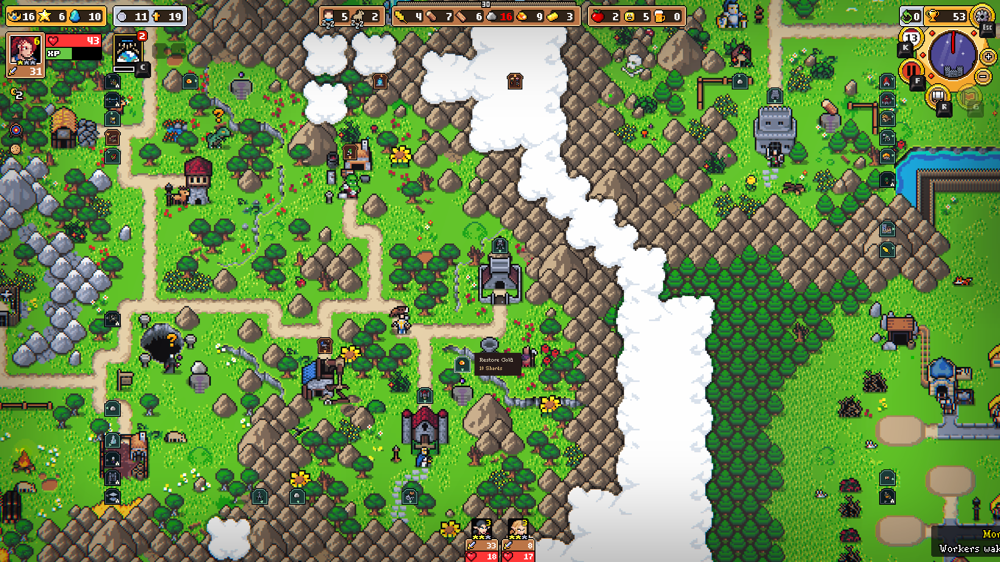
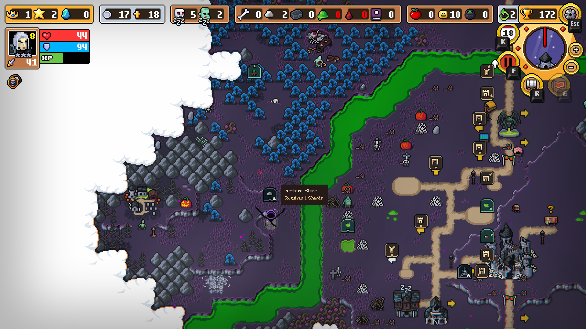

# Scout’s Map

Find discovered destinations and events without losing your place on the map. Hover a marker to see the destination and any requirement. Click an available marker to center the camera.

## Features

- **Find routes and services.** See markers for roads, city expansion, water access, shops, the Black Market, the Trading Post, and other discovered services.
- **Follow objectives.** Find open quests, turn-ins, restorable sites, encounters, rewards, recruits, and monsters to provoke.
- **Read availability at a glance.** Dimmed markers show a lock. Hover for a known cost, setup timer, or other requirement. Available markers get a white edge when you hover or press.
- **See where to go.** A marker sits above its visible target when there’s room. Directional arrows point to destinations beyond the visible map or behind the HUD.

## How to Use

1. Hover a marker to read its name and any cost or requirement.
2. Left-click an available marker to center the camera, then use the game’s normal interaction at the destination.
3. To hide a category, set it to `false` under `[Markers]` in `BepInEx/config/gkj.scoutsmap.cfg`. Apply the change in a BepInEx configuration UI or restart the game after editing the file by hand.

Gamepad players can see the markers while using the game’s usual controls. Marker selection uses the mouse. `RareFinds` and `UnitCages` are off by default.

## Screenshots

**Human · 1× UI scale**

**Undead · 1.5× UI scale**

## Compatibility

Scout’s Map supports Human and Undead kingdoms on Super Fantasy Kingdom 0.8.070. It uses the game’s discovery and availability rules and stores no save data.

Use [Visitor Calendar](https://thunderstore.io/c/super-fantasy-kingdom/p/GKJ/VisitorCalendar/) for arrival dates and [Production Bottlenecks](https://thunderstore.io/c/super-fantasy-kingdom/p/GKJ/ProductionBottlenecks/) for blocked building production. Both can be used alongside Scout’s Map.

## Installation

Open Thunderstore Mod Manager or r2modman, select **Super Fantasy Kingdom**, and install **ScoutsMap** by **GKJ**. Install both required dependencies when prompted, [BepInExPack](https://thunderstore.io/c/super-fantasy-kingdom/p/BepInEx/BepInExPack/) and [HideManagerGameObject Config](https://thunderstore.io/c/super-fantasy-kingdom/p/BepInEx/HideManagerGameObject_Config/). Launch the selected profile in modded mode.
